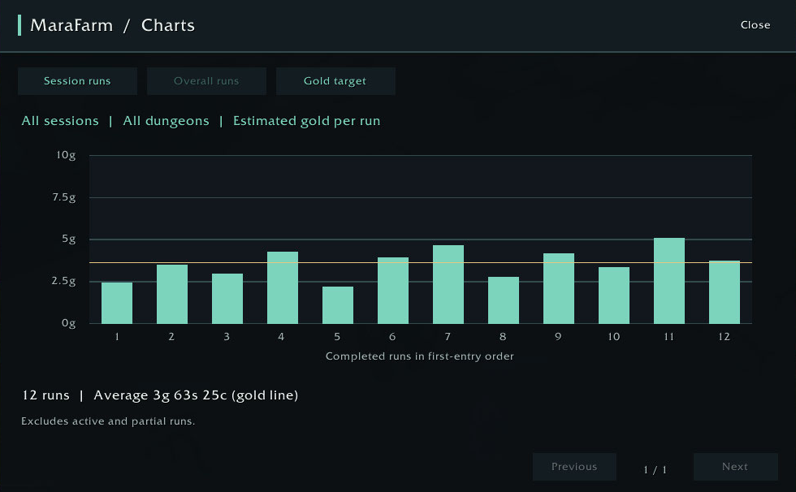
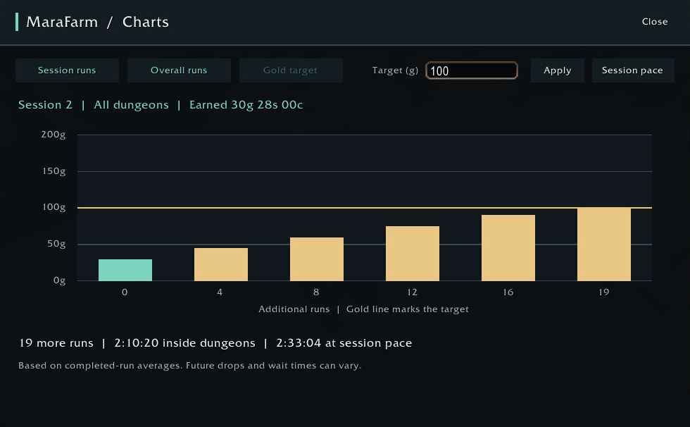
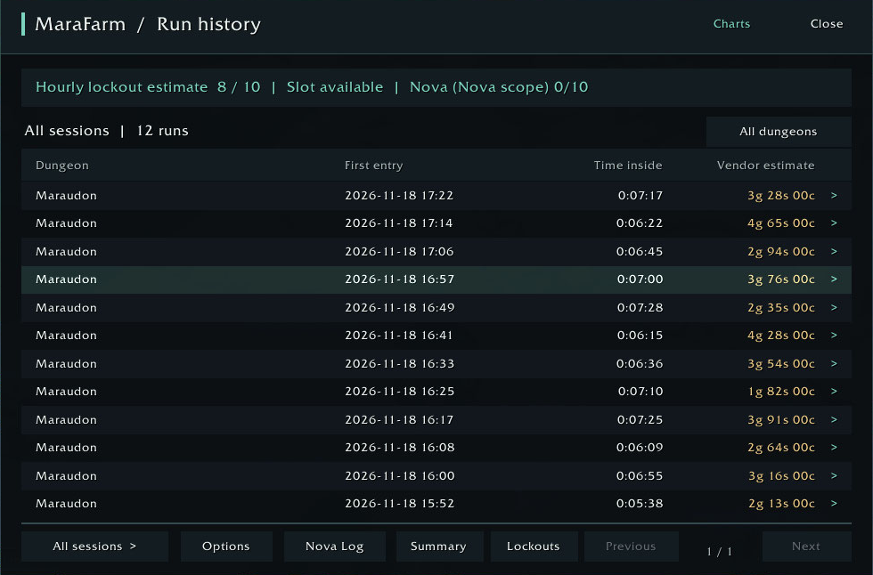
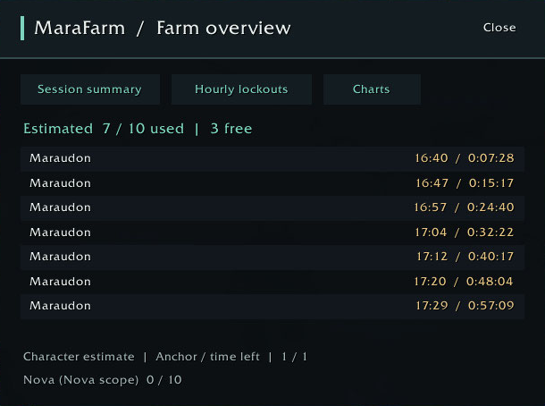
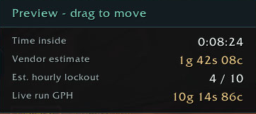

# MaraFarm

A World of Warcraft: Forever addon for tracking Maraudon and other dungeon farms. Type **/mf** to open your run history.

- Records first entry, visits, and time spent inside each dungeon run.
- Shows an estimated rolling hourly lockout count out of 10 for the current character.
- See personally looted uncommon, rare, and epic drops, including group-roll wins. Open a run and select a boss for unit prices and vendor subtotals. Loot without a confirmed source is listed under **Other / unknown source**.
- Shows a separate hourly count when Nova Instance Tracker 2.32 is loaded, with a shortcut to Nova's log.
- Shows a live dungeon overlay with time inside, vendor value, estimated hourly lockouts, and live run GPH.
- Use **/mf summary** for looted coin, estimated earnings, gold per run, and gold per hour. Use **/mf lockouts** to see estimated slot expiry by dungeon.
- Use **/mf charts** for session and overall earnings per run, plus projected runs and time to reach a gold target.
- Filter history by session or Maraudon. The movable Princess Theradras minimap button opens history or the summary.
- Opens settings with **/mf options** or the **Options** button in run history. Use **Preview / move** to drag the overlay, or **Reset session** to start fresh while keeping earlier runs and lockouts.
- Use **Tracked dungeons and overlay** to choose which dungeons are recorded. MaraFarm’s lockout estimate omits visits made while a dungeon is unchecked. **Clear all run history** removes MaraFarm history for every character after confirmation.

## Install on WoW Forever

1. Download the **MaraFarm versioned ZIP** from [GitHub Releases](https://github.com/jturnham/MaraFarm/releases/latest). GitHub's **Code → Download ZIP** and **Source code (zip)** downloads add an outer source folder.
2. Extract the ZIP and copy its **MaraFarm** folder into `World of Warcraft/_forever_/Interface/AddOns/`. Check that `_forever_/Interface/AddOns/MaraFarm/MaraFarm.toc` exists directly inside that folder.
3. Fully exit and restart WoW Forever, enable **MaraFarm** in the character-selection **AddOns** list, then log in and type **/mf**.

If MaraFarm is missing from the AddOns list, check for an extra folder level and confirm you're launching **WoW Forever**. If it appears and **/mf** does nothing, run `/console scriptErrors 1` followed by `/reload` and capture the first MaraFarm error.

See the [changelog](CHANGELOG.md) for release notes.

### Earnings charts

Use **`/mf charts`** to compare gold per completed run in the current session or across all sessions. Enter a gold target to estimate how many more runs and how much time it will take at your recorded pace.

### Run history and boss loot

Use **`/mf`** to browse runs and filter by session or Maraudon. Select a run and then a boss to see tracked green, blue, and purple drops, quantities, unit prices, and vendor subtotals.

| Run history | Boss loot |
| --- | --- |
|  |  |

### Summary and lockouts

Use **`/mf summary`** for looted coin, vendor value, average gold per run, and both in-instance and session GPH. Use **`/mf lockouts`** for estimated slot expiry. Nova Instance Tracker 2.32 can supply a separate comparison count.

| Farm summary | Hourly lockouts |
| --- | --- |
|  |  |

### Dungeon overlay and settings

The overlay shows time inside, vendor value, estimated lockout usage, and live run GPH. Use **`/mf options`** to preview and reposition it or start a fresh session while keeping earlier runs and lockouts. Left-click the Princess Theradras minimap button for history or right-click for the summary.

| Options | Dungeon overlay preview |
| --- | --- |
|  |  |
