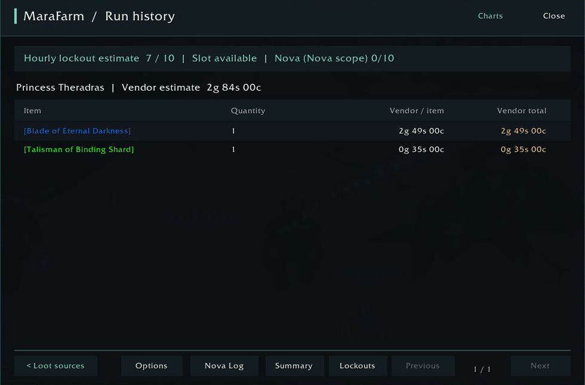
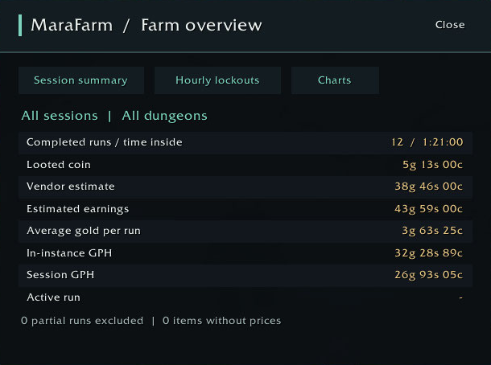
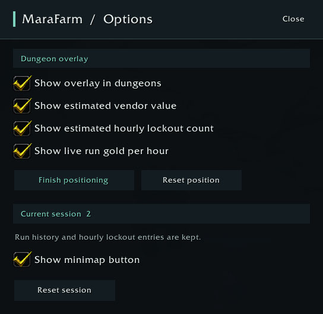

# MaraFarm

A World of Warcraft: Forever addon for tracking Maraudon and other dungeon farms. Record run times, estimate the vendor value of your loot, and see how close you are to the hourly instance cap.

Copy **MaraFarm** into `World of Warcraft/_forever_/Interface/AddOns/`, then type **`/mf`** in game.

## In-game screenshots

The screenshots use synthetic runs, loot, and prices to demonstrate the interface.

### Earnings charts

Use **`/mf charts`** to compare gold per completed run in the current session or across all sessions. Enter a gold target to estimate how many more runs and how much time it will take at your recorded pace.

### Run history and boss loot

Use **`/mf`** to browse runs and filter by session or Maraudon. Select a run and then a boss to see tracked green and blue drops, quantities, unit prices, and vendor subtotals.

| Run history | Boss loot |
| --- | --- |
|  |  |

### Summary and lockouts

Use **`/mf summary`** for looted coin, vendor value, average gold per run, and both in-instance and session GPH. Use **`/mf lockouts`** for estimated slot expiry. Nova Instance Tracker 2.32 can supply a separate comparison count.

| Farm summary | Hourly lockouts |
| --- | --- |
|  |  |

### Dungeon overlay and settings

The overlay shows time inside, vendor value, estimated lockout usage, and live run GPH. Use **`/mf options`** to preview and reposition it or start a fresh session while keeping earlier runs and lockouts. Left-click the Princess Theradras minimap button for history or right-click for the summary.

| Options | Dungeon overlay preview |
| --- | --- |
|  |  |
